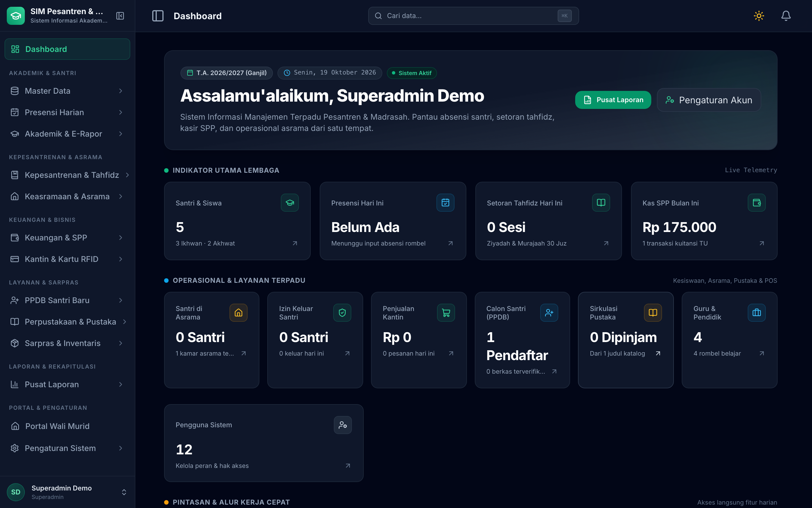
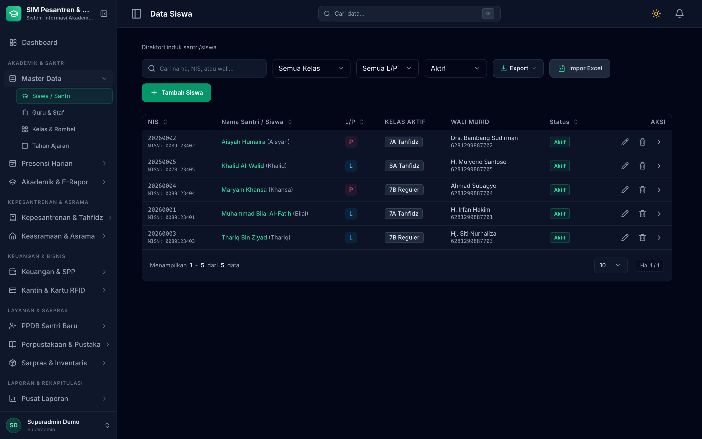
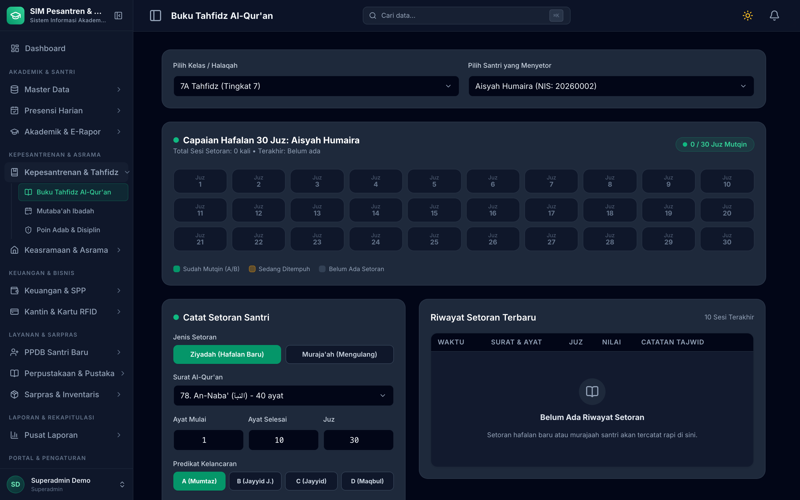
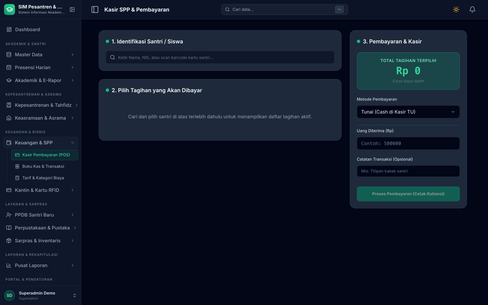
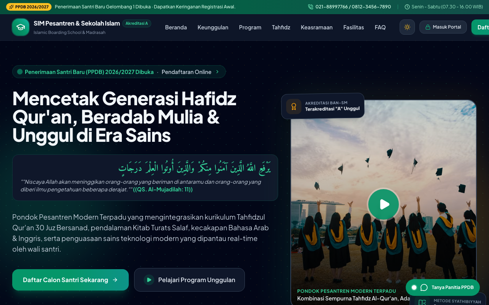
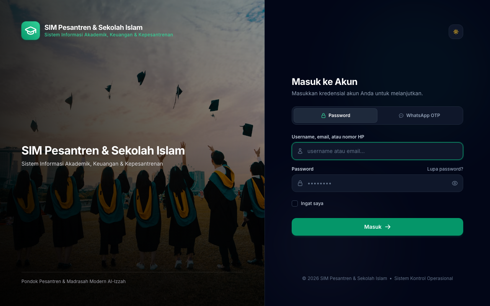

# SIM Pesantren & Sekolah Islam

[](https://laravel.com)
[](https://php.net)
[](https://livewire.laravel.com)
[](https://tailwindcss.com)
[](docs/instalasi.md#perintah-pengembangan--testing)
[](https://madrasah.solusikoding.com)
[](LICENSE)

**Stack:** Laravel 13 · PHP 8.3+ · Livewire 3 + Volt + Alpine.js · Tailwind CSS 3.4 · Laravel Reverb (Websocket) · Spatie Permission & Activitylog · Fonnte (WhatsApp Gateway) · Tripay (Payment Gateway) · Pest · Larastan · Pint

Sistem informasi manajemen sekolah Islam dan pondok pesantren terpadu (*all-in-one*). Menghubungkan administrasi tata usaha, kepesantrenan & tahfidz Al-Qur'an 114 surah, e-rapor akademik, kasir pembayaran SPP, presensi GPS & WhatsApp gateway, asrama & gate pass satpam, PPDB online, sarana prasarana, perpustakaan digital, serta smart card RFID dan portal mandiri untuk wali santri.

🌐 **Coba demo:** [madrasah.solusikoding.com](https://madrasah.solusikoding.com)

---

## Pratinjau Antarmuka

<p align="center">
  
</p>

<p align="center">
  
  
</p>

<p align="center">
  
  
</p>

<p align="center">
  
  
</p>

---

## Fitur

- **Master data terpadu**: Biodata lengkap santri (NIS, NISN, NIK, foto), impor data santri massal dari template Excel, data guru/asatidz, rombel kelas, dan kalender tahun ajaran aktif.
- **Presensi kelas & notifikasi WhatsApp**: Lembar absensi kelas satu klik dan notifikasi kehadiran otomatis dikirim ke nomor WhatsApp orang tua santri via gateway Fonnte.
- **Presensi mandiri guru (GPS Geofencing)**: Check-in dan check-out guru berbasis koordinat GPS dengan batas radius meter dari gerbang sekolah.
- **SIAKAD & e-rapor otomatis**: Jurnal mengajar guru harian, buku nilai formatif dan sumatif, serta cetak e-rapor otomatis berformat PDF resmi dengan kop sekolah.
- **Keuangan & kasir POS**: Kategori tarif fleksibel, generator tagihan rutin massal, skema keringanan/beasiswa santri, loket kasir pembayaran tunai dengan cetak kuitansi ber-kop surat dan teks terbilang rupiah, serta pembayaran online otomatis (Virtual Account, QRIS, gerai retail) via gateway Tripay.
- **Tahfidz Al-Qur'an 114 surah**: Pencatatan setoran ziyadah dan muraja'ah santri lengkap dengan surah, ayat, juz, halaman, nilai tajwid, dan kelancaran.
- **Mutaba'ah ibadah & buku saku**: Pemantauan amalan harian santri (shalat wajib 5 waktu, dhuha, tahajjud, rawatib, tilawah, puasa sunnah) serta buku saku poin kedisiplinan dan prestasi.
- **Keasramaan & scanner gerbang satpam**: Manajemen gedung & kamar asrama, perizinan keluar/pulang santri dengan persetujuan musyrif, serta scanner QR Code di pos satpam untuk validasi santri keluar-masuk.
- **PPDB online & konversi 1-klik**: Portal pendaftaran santri baru mandiri, alur seleksi & verifikasi berkas, dan konversi calon santri yang lolos seleksi menjadi santri resmi aktif beserta pembuatan akun wali santri secara otomatis.
- **Sarpras & perpustakaan**: Inventaris aset per ruangan dengan cetak label stiker QR Code, katalog buku (ISBN, rak, stok eksemplar), sirkulasi peminjaman, dan denda keterlambatan.
- **Smart card RFID & dompet digital**: Pairing kartu RFID fisik ke santri, pembatasan batas belanja harian (*daily limit*) oleh wali murid, dan POS kasir belanja kantin cashless.
- **Portal mandiri wali santri (PWA)**: Aplikasi web progresif yang dapat diinstal di smartphone orang tua untuk memantau hafalan, kehadiran kelas, nilai rapor, perizinan asrama, dan riwayat saku anak secara realtime.
- **Landing page profil & CMS**: Tampilan landing page berkarakter Islami modern (sambutan pimpinan, program unggulan, biaya, galeri) yang dapat diubah langsung dari menu pengaturan tanpa mengubah kode.
- **Pondasi sistem & keamanan**: 12 peran hierarki lembaga, login OTP WhatsApp bebas sandi, sakelar on/off fitur modul, log aktivitas & audit trail, backup database terjadwal, REST API v1 dengan dokumentasi interaktif Scalar di `/docs/api`, dan update data realtime via Laravel Reverb.

---

## Alur Kerja

1. **Penerimaan Santri Baru (PPDB)**: Calon santri mendaftar online $\rightarrow$ Panitia menyeleksi berkas & tes hafalan $\rightarrow$ Sekali klik konversi langsung menerbitkan NIS dan membuat akun wali santri.
2. **KBM, Presensi & Tahfidz**: Guru mengisi absensi kelas dan materi jurnal mengajar $\rightarrow$ Notifikasi absensi langsung terkirim ke WhatsApp orang tua $\rightarrow$ Musyrif mencatat setoran hafalan Al-Qur'an santri.
3. **Pengelolaan SPP**: Sistem membuat tagihan rutin $\rightarrow$ Pembayaran dapat dilakukan via kasir TU atau mandiri oleh wali via Virtual Account/QRIS $\rightarrow$ Kuitansi resmi diterbitkan otomatis.
4. **Keasramaan & Keamanan**: Santri mengajukan izin keluar lewat musyrif $\rightarrow$ Satpam di gerbang cukup memindai QR Code izin santri untuk verifikasi keluar dan kembali.
5. **Portal Mandiri Orang Tua**: Wali santri membuka portal (PWA) di ponsel untuk memantau seluruh riwayat kehadiran, setoran hafalan, saldo uang saku, dan e-rapor anak.

---

## Mulai Cepat

```bash
composer run setup   # instal dependensi, siapkan .env & database, buat akun superadmin
composer run dev     # jalankan web server, queue, scheduler, Vite, dan Reverb websocket
```

Buka `http://localhost:8000` di peramban Anda.

---

## Dokumentasi

- [Instalasi & Konfigurasi](docs/instalasi.md): Kebutuhan server, variabel `.env` (WhatsApp Fonnte, Tripay, GPS), akun demo, dan perintah pengujian
- [Arsitektur & Peta Modul](docs/arsitektur.md): Daftar rute & komponen Livewire, alur proses bisnis, hierarki 12 peran pengguna, dan REST API
- [Catatan Fondasi & Ekstensi](docs/starter.md): Standar arsitektur starter, checklist cara menambah modul baru, dan integrasi fitur

---

## Kontak

Dikembangkan oleh **rizalahmaddd**:
- **WhatsApp**: [+62 857-7777-5477](https://wa.me/6285777775477)
- **GitHub**: [@rizalahmaddd](https://github.com/rizalahmaddd)
- **Lokasi**: Kota Malang, Jawa Timur, Indonesia

---

## Lisensi

Proyek ini dilisensikan di bawah lisensi terbuka [MIT License](LICENSE).
Silakan digunakan, dipelajari, dan dikembangkan untuk memajukan sistem informasi lembaga pendidikan Islam di seluruh nusantara.
